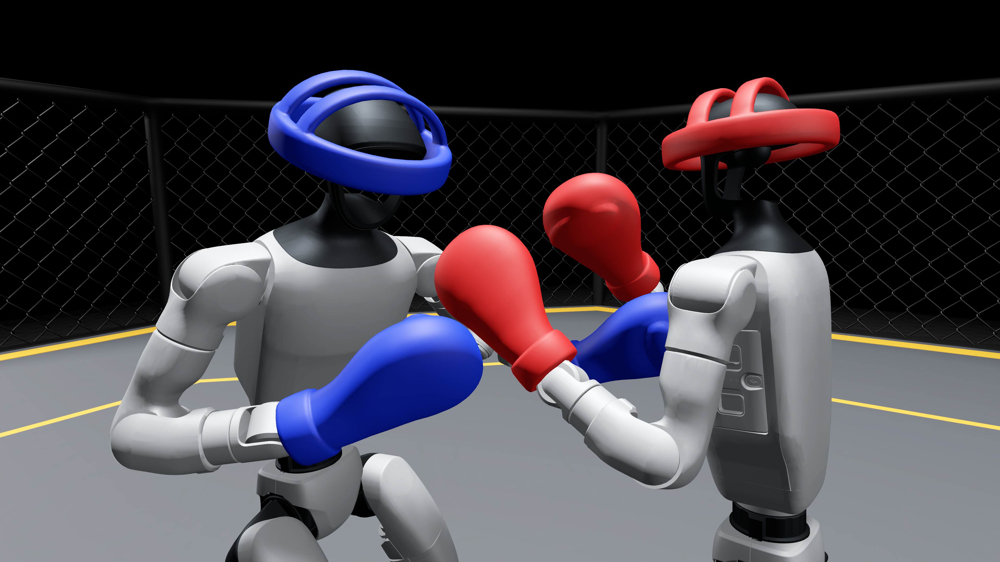

# MECHFIST

## 中文

**简介：** MechFist 是一款由 **Mech Wrangler** 制作的物理驱动机器人拳击 Demo。观看 AI 对战，或用摄像头和身体动作操控机器人，亲自迎战 AI。

**项目详情及游戏下载：** [项目官网](https://ycjinyi.github.io/mechfist/)

本项目将持续开发与完善，敬请关注后续进展及版本更新。

## English

**Introduction:** MechFist is a physics-driven robot boxing demo created by **Mech Wrangler**. Watch AI fighters face off, or use a camera and your own body movements to control a robot against AI.

**Project details and game downloads:** [Project website](https://ycjinyi.github.io/mechfist/)

Development and refinement will continue. Follow the project for further progress and release updates.
